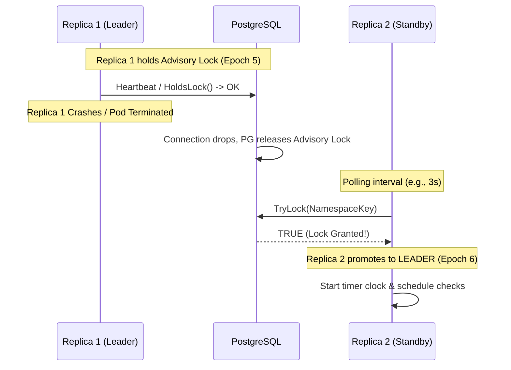

# Core Architecture & Distributed Coordination

`d-cron` provides safe, single-leader cron-style job scheduling across an arbitrary number of horizontally-scaled application replicas using only **PostgreSQL Session-Bound Advisory Locks**.

This guide covers the core architectural building blocks: advisory locks, leader election, failover loops, and the high-precision in-memory clock engine.

## 1. PostgreSQL Session Advisory Locks

Unlike traditional row-level locks (`SELECT FOR UPDATE`), PostgreSQL advisory locks exist purely in the PostgreSQL shared memory lock table and do not write to tables or generate WAL (Write-Ahead Logging) overhead.

| SQL Function | Scope | Behavior |
| :--- | :--- | :--- |
| `pg_try_advisory_lock(key BIGINT)` | Session-Bound | Attempts to acquire a 64-bit lock instantly. Returns `true` on success, `false` immediately without blocking if acquired elsewhere. |
| `pg_advisory_unlock(key BIGINT)` | Session-Bound | Releases the advisory lock bound to the active database connection session. |

### Session-Bound Architecture

Session-bound advisory locks are attached directly to the **underlying TCP connection session** between your Go application node and PostgreSQL:

```
┌─────────────────────────────────┐                 ┌─────────────────────────────────┐
│       App Node (Replica A)      │                 │       App Node (Replica B)      │
│  Dedicated DB Connection (Conn1) │                 │  Dedicated DB Connection (Conn2) │
└────────────────┬────────────────┘                 └────────────────┬────────────────┘
                 │                                                   │
                 │ pg_try_advisory_lock(84920491)                    │ pg_try_advisory_lock(84920491)
                 │  ==> TRUE (Acquired)                              │  ==> FALSE (Leader Active)
                 ▼                                                   ▼
┌─────────────────────────────────────────────────────────────────────────────────────┐
│                               PostgreSQL Memory Engine                              │
│  Advisory Lock Table: [Key: 84920491, SessionID: 10492 (Conn1)]                    │
└─────────────────────────────────────────────────────────────────────────────────────┘
```

1. **Automatic Cleanup on Crash**: If Replica A crashes, power-cycles, or experiences network partition, PostgreSQL automatically drops `Conn1` and **releases the advisory lock within seconds** (or TCP keepalive timeout).
2. **Zero Disk I/O**: Acquiring or checking an advisory lock touches zero table buffers and generates zero WAL bloat.

## 2. Deterministic Key Resolution

`d-cron` derives a deterministic 64-bit advisory lock key from your configured namespace string (e.g. `orders-service`):

```go
// LockKey derives the deterministic 64-bit advisory-lock key from namespace:
// key = int64 from the first 8 bytes of sha256("d-cron:v1:" + namespace)
func LockKey(namespace string) int64 {
    h := sha256.Sum256([]byte("d-cron:v1:" + namespace))
    k := int64(binary.BigEndian.Uint64(h[:8]))
    if k == 0 {
        return 1
    }
    return k
}
```

- Independent microservices running on the same PostgreSQL database use different namespace strings and never collide.
- All replicas of the *same* microservice generate the exact same 64-bit lock key to contend for single-leader status.

## 3. Leader Election & Failover Loop

`d-cron` operates a **Single Active Leader** execution model. Across `N` running replicas, exactly **one** node acts as the active Leader, while the remaining `N-1` nodes remain in Standby mode.

### State Machine

```
        ┌──────────────┐
        │   INIT /     │
        │   STARTUP    │
        └──────┬───────┘
               │
               ▼
┌──────────────────────────────┐       Acquire Advisory Lock      ┌──────────────────────────────┐
│                              ├─────────────────────────────────►│                              │
│           STANDBY            │                                  │            LEADER            │
│  - Polls Lock Periodically   │◄─────────────────────────────────┤  - Runs Cron Timer Clock     │
│  - Clock Suspended           │       Lost Lock / Network Loss   │  - Dispatches Scheduled Jobs │
│                              │                                  │  - Increments Epoch Token    │
└──────────────────────────────┘                                  └──────────────────────────────┘
```

1. **Standby State**: The instance periodically attempts to acquire the advisory lock key using `TryLock`. The timer clock is **suspended**. CPU usage is virtually zero.
2. **Leader State**: When `TryLock` returns `true`, the instance transitions to **Leader**, increments its monotonic **Leader Epoch** (e.g. from Epoch 4 to Epoch 5), and wakes the timer engine to evaluate job schedules.
3. **Heartbeat Verification**: A background routine periodically executes `HoldsLock` to verify that the active database session remains healthy.

### Failover Flow Sequence

When the active leader node is terminated during a deployment or unexpected crash:



## 4. In-Memory Clock Engine & Worker Pools

When an instance becomes Leader, `d-cron` initializes an internal min-heap timer wheel containing all registered cron entries (`robfig/cron/v3` semantics):

```
                  ┌───────────────────────────────┐
                  │      Leader Timer Engine      │
                  └──────────────┬────────────────┘
                                 │ Next Trigger Evaluation
                                 ▼
              ┌──────────────────────────────────────┐
              │  Sorted Min-Heap (Next Run Timestamps)│
              │  1. 10:00:00 - billing-sync          │
              │  2. 10:05:00 - telemetry-flush       │
              │  3. 10:15:00 - cache-prune           │
              └──────────────────┬───────────────────┘
                                 │ Sleep until 10:00:00
                                 ▼
                     ┌───────────────────────┐
                     │ Worker Goroutine Pool │
                     └───────────────────────┘
```

### Clock Engine Highlights

1. **Zero Polling Drift**: Rather than waking every second to query the database, `d-cron` calculates the exact duration until the next earliest job trigger time and sleeps.
2. **Isolated Worker Goroutines**: When a job fires, execution is dispatched to an isolated goroutine from the worker pool with built-in panic recovery.
3. **Panic Protection**: A panic in one job handler is caught, logged with full stack traces via `log/slog`, and never crashes the application or halts the timer wheel.

## Advisory Locks vs Row Locks Comparison

| Metric / Feature | Row-Level Locks (`SELECT FOR UPDATE`) | Session Advisory Locks (`d-cron`) |
| :--- | :--- | :--- |
| **Disk Bloat / Dead Tuples** | High (Writes tuple xmin/xmax) | **Zero** |
| **WAL Generation** | Yes | **No** |
| **Automatic Cleanup on Crash** | Relies on transaction abort | **Automatic (Session Drop)** |
| **Connection Overhead** | Requires active open transaction | **Uses 1 Dedicated DB Connection** |
| **Lock Latency** | ~2–5 ms | **< 0.5 ms** |
| **Heap Reschedule Overhead** | N/A | **< 250 ns per job** |
| **Trigger Precision** | Unpredictable (DB contention) | **< 1 ms variance** |

## Elector Backend Interface

`d-cron` defines a clean interface for advisory lock operations behind `internal/elector.Backend`, enabling unit and integration testing without a live database:

```go
type Backend interface {
    TryLock(ctx context.Context, key int64) (acquired bool, pid int, err error)
    HoldsLock(ctx context.Context, key int64) (bool, error)
    Release(ctx context.Context, key int64) (bool, error)
    Close() error
}
```

The production implementation (`NewStdBackend`) manages a dedicated session-stable `*sql.Conn` that holds the advisory lock for the duration of the leadership tenure.
